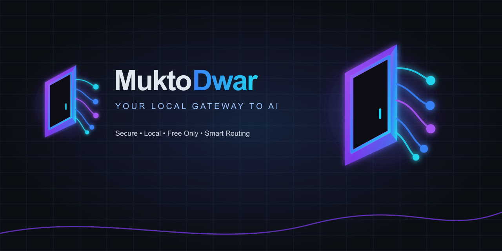

# MuktoDwar



**MuktoDwar** (মুক্তদ্বার, *free gate*) is a lightweight, secure, **local-only** AI gateway for Windows. It exposes an **OpenAI-compatible API** on `127.0.0.1:8787` and routes requests across multiple **explicitly allowlisted free** AI providers and multiple API keys per provider.

**Free-only by construction.** There is no code path that can route to a model you have not allowlisted, and no code path that can fall back to a paid model.

**Live site (GitHub Pages):** https://habibbrox2.github.io/MuktoDwar/

## How it works

MuktoDwar is a local-only Node.js gateway that exposes an OpenAI-compatible API on `127.0.0.1:8787`. It routes requests across multiple explicitly allowlisted free providers and keys, with hybrid routing (priority, latency, health). Secrets are stored encrypted with Windows DPAPI. The admin dashboard is served from the same process.

## Usage

1. Install and verify: `npm ci && npm run verify`
2. Start: `npm start` (opens the dashboard automatically).
3. On first run, the administrator token is printed once in the console. Use it to sign in.
4. Add providers (Kilo and OpenCode are enabled by default; Cloudflare requires your account ID + API token).
5. Allowlist free models, configure routing, and test via the API Playground.
6. Rotate gateway/admin tokens from the Tokens page when needed.

## Brand assets

MuktoDwar uses the **Open Gateway** identity: a neon open door with connected routing nodes, on a dark navy canvas. See the complete [brand guide](docs/brand/muktodwar-brand-guide.md).

## Brand assets

MuktoDwar uses the **Open Gateway** identity: a neon open door with connected routing nodes, on a dark navy canvas. See the complete [brand guide](docs/brand/muktodwar-brand-guide.md).

| Asset | Intended use |
|---|---|
| [`muktodwar-logo-dark.svg`](assets/brand/muktodwar-logo-dark.svg) | README, dark navbars, and splash screens |
| [`muktodwar-logo-light.svg`](assets/brand/muktodwar-logo-light.svg) | Light surfaces |
| [`muktodwar-mark.svg`](assets/brand/muktodwar-mark.svg) | Compact UI, app, and tray contexts |
| [`muktodwar.ico`](assets/brand/muktodwar.ico) | Windows application icon |
| [`muktodwar-favicon.svg`](assets/brand/muktodwar-favicon.svg) | Browser favicon |
| [`muktodwar-github-banner.png`](assets/brand/muktodwar-github-banner.png) | GitHub repository/social preview |

Regenerate binary derivatives after changing the master generator:

```powershell
npm run brand:build
```

---

## What it does

- 🖥️ **Local only** — binds to `127.0.0.1` and refuses to start on any other address. No cloud account, no external hosting, no telemetry, no auto-updates.
- 🔌 **OpenAI-compatible** — works unchanged with the official OpenAI SDKs, OpenCode, PHP, JavaScript, and anything that speaks `POST /v1/chat/completions`.
- 🔀 **Hybrid router** — combines your priority order, measured latency (EWMA), provider health, cooldown and circuit breaking.
- 🆓 **Free-only** — every model must be **explicitly allowlisted** and marked free by you; a provider that needs no key is called anonymously, and there is no paid fallback.
- 🔐 **Windows DPAPI secret storage** — API keys encrypted at rest with `CurrentUser` scope, **never** plaintext, fail-closed on any error.
- 📡 **Streaming** — SSE with backpressure, streamed straight through without buffering the upstream response.
- 🧪 **Tested** — 154 tests: unit, integration, security, routing, streaming, configuration.

---

## Requirements

- **Windows 10/11** (DPAPI is Windows-only)
- **Node.js ≥ 22.12** (developed and verified on Node 26)
- PowerShell 5.1 (ships with Windows; used only for DPAPI)
- At least one API key from a provider in [docs/providers.md](docs/providers.md), **or** a local Ollama / LM Studio install

---

## Install and run

```powershell
npm ci             # reproducible install from package-lock.json
npm run verify     # typecheck + tests + build
npm run sync:models # refresh the free-model catalogue from models.dev
npm start          # serves on http://127.0.0.1:8787
```

For development with hot reload:

```powershell
npm run dev
```

### First run

On first run the gateway creates `%LOCALAPPDATA%\LocalAIGateway\` containing:

| File | Contents |
|---|---|
| `config.json` | providers, model allowlist, routing — ACL'd to your account |
| `secrets.json` | **DPAPI-encrypted** API keys and tokens — never plaintext |

It generates a **gateway token** and an **admin token**. The admin token is printed to the console **once, at creation** — copy it now. It is never printed again on restart and never written to disk in plaintext.

```powershell
# If you lose the admin token later, recover it deliberately:
node dist/index.js --show-admin-token

# Replace it — the new token is printed once, the old one stops working.
# The same rotation is available in the dashboard (Tokens section).
node dist/index.js --rotate-admin-token
```

---

## Configure a provider

Everything is done in the admin UI, or by calling the admin API directly.

```
GET  /admin/catalog          # what the gateway knows about each provider
POST /admin/providers        # add a provider
POST /admin/providers/:id/models   # allowlist a model
PUT  /admin/routing          # priority weights, max attempts, default model
POST /admin/tokens/gateway/rotate   # rotate the client token
POST /admin/tokens/admin/rotate     # replace the admin token (shown once)
POST /admin/session          # exchange admin token for a session cookie
DELETE /admin/session        # sign out
```

Example — add Groq and allowlist a free model:

```powershell
$admin = @{ authorization = "Bearer <ADMIN_TOKEN>" }

Invoke-RestMethod -Method Post -Uri http://127.0.0.1:8787/admin/session -Headers $admin

Invoke-RestMethod -Method Post -Uri http://127.0.0.1:8787/admin/providers `
  -Headers $admin -ContentType 'application/json' -Body (@{
    id = 'groq'; kind = 'groq'; label = 'Groq'; enabled = $true; priority = 10
  } | ConvertTo-Json)

# Save your API key — it is encrypted with DPAPI immediately.
Invoke-RestMethod -Method Post -Uri http://127.0.0.1:8787/admin/providers/groq/models `
  -Headers $admin -ContentType 'application/json' -Body (@{
    id = 'llama-3.3-70b-versatile'; free = $true; verified = $true
  } | ConvertTo-Json)
```

> **Free status is your assertion.** See [docs/providers.md](docs/providers.md) for what has been verified from official documentation and what has not.

---

## Client configuration

Point any OpenAI-compatible client at the gateway:

| Setting | Value |
|---|---|
| **Base URL** | `http://127.0.0.1:8787/v1` |
| **API key** | your **gateway token** (any non-empty string works for some clients; only your real token is accepted) |
| **Model** | `mukto-auto/free` |

`mukto-auto/free` is the gateway's own model id: it means *any free model
you have allowlisted*. Configure it once and the client keeps working
when you allowlist a new model or add a provider - the gateway resolves
it at request time and tells you in the reply which model actually
served the request. The pinned ids are in `GET /v1/models` if you prefer
one.

The dashboard's **Tokens** tab has a **Copy client config** button that
copies the whole configuration — endpoint, token and alias — as JSON,
as an OpenCode `opencode.json` fragment, as a Continue `config.yaml` or
as an environment variable.

> **[docs/connect-a-client.md](docs/connect-a-client.md)** is the full guide:
> step by step setup, a recipe for every client (OpenAI SDK, OpenCode,
> Continue, Cline, Aider, LiteLLM, LangChain, PHP, PowerShell), how to keep
> the token out of your code, and what every error means.

### OpenAI SDK (JavaScript / TypeScript)

```js
import OpenAI from 'openai';

const client = new OpenAI({
  baseURL: 'http://127.0.0.1:8787/v1',
  apiKey: process.env.GATEWAY_TOKEN,
});

const completion = await client.chat.completions.create({
  model: 'llama-3.3-70b-versatile',
  messages: [{ role: 'user', content: 'Hello!' }],
});
console.log(completion.choices[0].message.content);

// Streaming
const stream = await client.chat.completions.create({
  model: 'llama-3.3-70b-versatile',
  messages: [{ role: 'user', content: 'Hello!' }],
  stream: true,
});
for await (const chunk of stream) {
  process.stdout.write(chunk.choices[0]?.delta?.content ?? '');
}
```

### OpenAI SDK (Python)

```python
from openai import OpenAI
import os

client = OpenAI(
    base_url="http://127.0.0.1:8787/v1",
    api_key=os.environ["GATEWAY_TOKEN"],
)

resp = client.chat.completions.create(
    model="llama-3.3-70b-versatile",
    messages=[{"role": "user", "content": "Hello!"}],
)
print(resp.choices[0].message.content)
```

### PHP

```php
<?php
$ch = curl_init('http://127.0.0.1:8787/v1/chat/completions');
curl_setopt_array($ch, [
    CURLOPT_POST           => true,
    CURLOPT_RETURNTRANSFER => true,
    CURLOPT_HTTPHEADER     => [
        'Content-Type: application/json',
        'Authorization: Bearer ' . getenv('GATEWAY_TOKEN'),
    ],
    CURLOPT_POSTFIELDS => json_encode([
        'model'    => 'llama-3.3-70b-versatile',
        'messages' => [['role' => 'user', 'content' => 'Hello!']],
        'stream'   => false,
    ]),
]);
echo json_decode(curl_exec($ch), true)['choices'][0]['message']['content'];
```

### curl

```powershell
curl http://127.0.0.1:8787/v1/chat/completions `
  -H "Content-Type: application/json" `
  -H "Authorization: Bearer $env:GATEWAY_TOKEN" `
  -d '{\"model\":\"llama-3.3-70b-versatile\",\"messages\":[{\"role\":\"user\",\"content\":\"Hello!\"}]}'
```

### OpenCode

Set the provider to an **OpenAI-compatible** endpoint with base URL `http://127.0.0.1:8787/v1` and your gateway token, then pick any model returned by `GET /v1/models`.

---

## Endpoints

| Method | Path | Auth | Purpose |
|---|---|---|---|
| `GET` | `/health` | none | liveness, counts, no secrets |
| `GET` | `/v1/models` | gateway token | allowlisted **free** models |
| `POST` | `/v1/chat/completions` | gateway token | completions, `stream: true` for SSE |
| `POST` | `/v1/embeddings` | gateway token | embeddings |
| `POST` | `/v1/images/generations` | gateway token | image generation |
| `POST` | `/v1/responses` | gateway token | Responses API (non-streaming) |
| `GET` | `/` | none | administration UI |
| `*` | `/admin/*` | admin token or session | configuration and key management |

Errors are OpenAI-shaped throughout:

```json
{ "error": { "message": "...", "type": "invalid_request_error", "code": "invalid_request" } }
```

A request for a model that is not allowlisted returns **404 `no_candidate`** *before* any upstream call is made.

---

## Commands

```powershell
npm run dev         # tsx watch, hot reload
npm run build       # tsc -p tsconfig.build.json  → dist/
npm start           # node dist/index.js
npm run typecheck   # tsc --noEmit, strict
npm test            # vitest run  (154 tests)
npm run test:watch  # vitest watch
npm run verify      # typecheck + test + build
```

**Verified results** (2026-10-20, Windows 10 22H2, Node 26.9.0):

```
Test Files  7 passed (7)
     Tests  121 passed (121)
```

| Suite | Tests | Covers |
|---|---|---|
| `dpapi` | 12 | round trip, corruption, missing PowerShell, timeout, malformed output, no secret in errors |
| `secret-store` | 12 | no plaintext on disk, fail-closed, cache TTL/invalidation, batching |
| `security` | 16 | loopback guard, Host header, origin, bearer, sessions, secret ids |
| `redact` | 12 | credential patterns, registered values, nested structures |
| `router` | 26 | free-only enforcement, priority, failover, cooldown, breaker, request shaping, upstream paths |
| `api` | 25 | health, models, chat, SSE, embeddings, images, responses, 421 guard, admin auth |
| `config` | 18 | validation, defaults, corruption, atomicity |

---

## How free-only is enforced

1. `providerConfigSchema` requires `free` and `verified` as **explicit booleans** — nothing is inferred.
2. Providers default to **`enabled: false`**.
3. `Router.candidates()` has a single choke point: `if (!entry.free) continue;` — a non-free model never becomes a candidate.
4. `GET /v1/models` only returns free, allowlisted models.
5. `maxAttempts` (default 3, max 5) hard-bounds upstream attempts per request.
6. BazaarLink requests send `X-Free-Fallback: false`, so a quota overage **cannot** silently switch to paid.
7. There is no paid provider, no billing integration, and no code that fetches a paid model.

---

## Architecture

```
src/
├── index.ts              entrypoint: guards → config → listen on 127.0.0.1
├── app.ts                Fastify assembly, hooks, error handling
├── api/
│   ├── routes.ts         /health, /v1/models, /v1/chat/completions (SSE)
│   └── admin.ts          /admin/* configuration and token management
├── config/
│   ├── schema.ts         zod schema — validation is the security boundary
│   ├── store.ts          load / persist / atomic write
│   └── paths.ts          %LOCALAPPDATA% paths, atomic writes, icacls ACL
├── providers/
│   ├── catalog.ts        verified facts: base URLs, caveats, free models
│   ├── adapter.ts        one OpenAI-compatible adapter, profile-driven
│   ├── router.ts         hybrid routing, failover, free-only choke point
│   └── health.ts         EWMA latency, cooldown, circuit breaker
├── security/
│   ├── dpapi.ts          PowerShell DPAPI driver (fail-closed)
│   ├── secret-store.ts   encrypted persistence + bounded cache
│   ├── localhost.ts      bind guard, Host check, origin check
│   ├── auth.ts           tokens, sessions, constant-time compare
│   └── redact.ts         log redaction (patterns + registered values)
└── ui/                   symbol-only administration UI (vanilla HTML/CSS/JS)
```

Design notes:

- **Adapters are data, not classes.** Provider differences (base URL, headers, dropped parameters) live in `catalog.ts` and an `AdapterProfile`, so adding a provider is usually a catalog entry.
- **The router is the only place that picks a provider.** Routes never branch on provider kind.
- **The secret store sits behind `DpapiDriver`**, so a native implementation can replace the PowerShell one without touching the rest of the gateway.

---

## Troubleshooting

### `Refusing to start: the gateway may only bind to 127.0.0.1`

Your `config.json` has a non-loopback `host`. This is deliberate — the gateway is local-only. Restore `"host": "127.0.0.1"` in `%LOCALAPPDATA%\LocalAIGateway\config.json`.

### `421 The gateway only accepts requests addressed to the loopback interface`

The `Host` header is not loopback — this is the DNS-rebinding control. Reach it as `http://127.0.0.1:8787` or `http://localhost:8787`.

### `401` on `/v1/*`

Missing or wrong bearer token. The **gateway token** is not the **admin token** — they are separate secrets. Use the gateway token for clients.

### `503 … the gateway token has not been configured`

No gateway token exists yet. Generate one from the admin UI, or `POST /admin/tokens/gateway/rotate`.

### `404 no_candidate` for a model

No enabled provider with an enabled key allowlists that model. Check `GET /v1/models`. The name match is case-insensitive and treats `_` as `-`.

### `502 all_attempts_failed`

Every permitted candidate failed. `error.attempts` lists each provider, model, key and reason. Common causes: a rejected key (401/403), a rate limit (429), or the model being removed upstream.

### `POWERSHELL_NOT_FOUND` / `DPAPI_TIMEOUT`

DPAPI could not run. Check that `%SystemRoot%\System32\WindowsPowerShell\v1.0\powershell.exe` exists. **The gateway fails closed — it will not fall back to storing plaintext.** If this persists, secret storage is unavailable and keys cannot be read.

### Streaming reaches the client late or buffered

Confirm no proxy sits in front; the gateway sets `X-Accel-Buffering: no` and `Cache-Control: no-cache, no-transform`.

### A provider keeps returning `429`

Free tiers are rate-limited. The router records it, applies cooldown, and fails over to another key or provider. Wait for the cooldown, add another key, or lower that provider's priority.

---

## Security

Read [SECURITY.md](SECURITY.md) — threat model, DPAPI design, cache lifecycle, failure behaviour and test evidence.

Quick version: local-only bind, DPAPI `CurrentUser` at rest, constant-time auth, redacted logs, no plaintext fallback, no telemetry, no paid fallback.

---

## Provider status

See [docs/providers.md](docs/providers.md) for the full verification matrix with official sources and the 2026-10-21 verification date.

**Verified free (no card):** Gemini, Groq, SambaNova, Kilo, OpenCode, Requesty · **Local:** Ollama, LM Studio · **Ships disabled (status unverified):** BazaarLink, Zhipu, AnyAPI, Poolside, Mistral, OpenRouter, Cline, SiliconFlow · **Rejected:** Cerebras, GitHub Models, HuggingFace, DeepSeek, Together, Fireworks, AIML, and others with no qualifying free tier.

---

## Limitations and known issues

- **Windows only.** DPAPI and the PowerShell codec are Windows-specific.
- **No audio or batch endpoints.** Embeddings, image generation and the Responses API are implemented as pass-throughs; streaming (`stream: true`) is only supported for chat completions, and `/v1/responses` is non-streaming.
- **Tool calls are passed through** but not translated; provider support varies.
- **OpenCode free-model streaming is unconfirmed** — verify before relying on SSE through it.
- **Mistral has no pre-allowlisted model** — its Free-mode roster is not published; add ids yourself from your organisation's limits page.
- **No model is pre-allowlisted for AnyAPI or Poolside** — official docs name free models but do not publish their exact API id strings.
- **`verified` means "free on 2026-10-20"**, never "free forever". Free tiers change; re-read the matrix when you see new `429`s or `404`s.
- **Health state is in-memory** and intentionally resets on restart.
- **Admin UI is a single page** with no history or undo; changes persist immediately.


## Building for Windows

A GitHub Actions workflow (`.github/workflows/release.yml`) builds the
single-file Windows executable and both installers on the `windows-latest`
runner, on every push to `main` and on version tags (`v*`). A push to
`main` leaves the build in the workflow artifacts; a **GitHub release is
published for a tag only**, so the releases list holds the versions and
not a build per commit.

Local build:

```powershell
npm ci
npm run build
npm run build:sea
```

The executable is written to `build/muktodwar.exe`. One script then produces
both installers from that single build:

```powershell
pwsh -File scripts/build-installers.ps1
```

- `build/installer/MuktoDwar-Setup.exe` — Inno Setup installer (end users)
- `build/installer/MuktoDwar.msi` — Windows Installer package (IT / managed deployment)

Both carry the same version, install into `C:\Program Files\MuktoDwar`, add the
same Start Menu and desktop shortcuts, register their own uninstaller in
Add/Remove Programs, and keep your settings and API keys on upgrade and on
uninstall.

Want a build without publishing a release? Run the **Windows Test Build**
workflow (`.github/workflows/windows-test-build.yml`) from the Actions tab. It
uploads the executable and both installers as artifacts that expire in 7 days,
and never creates a Release or a tag.

## Releases

Windows builds are published automatically via GitHub Actions on version
tags. A push to `main` builds the installers too, but keeps them in the
workflow artifacts.

- **Latest release:** https://github.com/habibbrox2/MuktoDwar/releases/latest
- **All releases:** https://github.com/habibbrox2/MuktoDwar/releases

Each release includes:

- `muktodwar.exe` — single-file executable
- `MuktoDwar-Setup.exe` — Inno Setup installer
- `MuktoDwar.msi` — Windows Installer package

Full A-to-Z guide: [docs/deployment/windows-build-release.md](docs/deployment/windows-build-release.md).


## Credits

- **Made in Bangladesh** 🇧🇩
- **Open Source** — MIT License
- **Developer:** Hr Habib
- GitHub: https://github.com/habibbrox2

## Desktop application

MuktoDwar ships as a true Windows desktop application:

- Single-file muktodwar.exe (no console window) with the MuktoDwar brand icon.
- Standalone window via Edge/Chrome app mode (no address bar); closing the window stops the server.
- Inno Setup installer and MSI, both with uninstaller entry in Add/Remove Programs.
- DPAPI-encrypted secrets, local-only binding, free-only routing.
